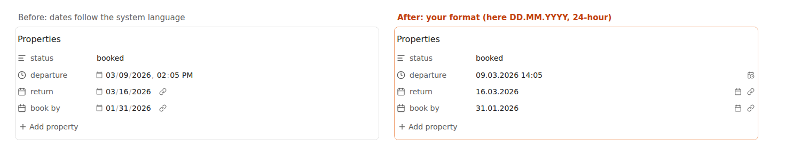

# Property Date Format

Obsidian shows dates in Properties the way your operating system's language says. If your system is in US English
and you think in `DD.MM.YYYY`, you get `03/09/2026, 02:05 PM` and there is no setting to change it. The
[forum request](https://forum.obsidian.md/t/64139) for one has been open since 2023.

This plugin adds that setting.

Pick a date format and a time format in **Settings → Property Date Format**. Presets cover `YYYY-MM-DD`,
`DD.MM.YYYY`, `DD/MM/YYYY`, `MM/DD/YYYY`, `D MMM YYYY` and a few more, and you can type any
[Moment.js format](https://momentjs.com/docs/#/displaying/format/). Time is `HH:mm` (24-hour) or `h:mm A`.

Only the display changes. The note keeps the standard value (`due: 2026-03-09`), so Bases, Dataview, search and
other apps read it exactly as before.

## Typing dates

Click a date and type it in your own format: `24.12.2026` is saved as `2026-12-24`. Pasting `2026-12-24` works too.
If the plugin can't read what you typed (say `31.02.2026`), the field gets a red underline and the note is not
changed; press Escape to get the old value back. The calendar button next to each date opens Obsidian's usual
date picker.

It works in the Properties panel of a note and in Bases table cells.

## Install

In Obsidian: **Settings → Community plugins → Browse**, search for "Property Date Format", install and enable it.

Manual install: download `main.js`, `manifest.json` and `styles.css` from the
[latest release](https://github.com/prometheus-maker/property-date-format/releases/latest) into
`<vault>/.obsidian/plugins/property-date-format/`.

## Limits

Obsidian has no public API for the property editor, so the plugin puts its own text field in front of Obsidian's
date input and finds those inputs by their CSS class. A future Obsidian update could rename them; if dates suddenly
look stock again, that's why, and an issue here helps. Tested on Obsidian 1.15 desktop (Linux). I haven't tested
it on mobile yet.

## Licence

MIT
